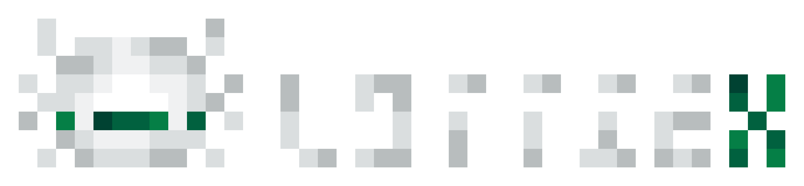

<div align="center">
  
  <h1>LottieX</h1>
  <p><strong>A small C++20 HTTP server and reverse proxy for hackathon demos.</strong></p>
  <p>
    
    
    
    <a href="LICENSE"></a>
  </p>
  <p>
    <a href="docs/en.md">English documentation</a> •
    <a href="docs/ru.md">Документация на русском</a> •
    <a href="lottiex.json">Configuration</a> •
    <a href="LICENSE">License</a>
  </p>
</div>

---

LottieX serves HTML, CSS, JavaScript, images and other files from a directory of your choice. A single `lttx` executable, a `lottiex.json` configuration file and a GNU Make build are all you need to serve a static site or put multiple HTTP applications behind one address.

## Features

- **Static file serving:** GET and HEAD, extension-based MIME types and configurable directory indexes.
- **Reverse proxy:** exact and segment-prefix routes, optional prefix stripping, request bodies, redirects, cookies and streaming SSR/SSE.
- **JSON configuration:** numeric IPv4/IPv6 listener, DNS names for upstream services, and configurable limits and timeouts.
- **Configuration validation:** the `check` command validates settings and the static root without starting the server.
- **Path containment:** requests containing `..` and symlinks that resolve outside the static root receive 404.
- **File streaming:** files are read in blocks of up to 64 KiB without loading the entire file into a response string.
- **Concurrent requests:** 8 worker threads, a queue of up to 64 connections and 30-second read and write timeouts.
- **Graceful shutdown:** SIGINT and SIGTERM stop new work from entering the queue and let accepted work finish.
- **Offline builds:** cpp-httplib and nlohmann/json are bundled in the repository.

## Quick start

You need Linux, GNU Make and a compiler with a C++20 standard library. Python 3 is required only for smoke tests; `curl` is used in the HTTP examples.

Install without Git (requires curl and tar):

```bash
curl -fsSL https://raw.githubusercontent.com/thekeny/LottieX/master/install.sh | bash
```

Or install from a local checkout:

```bash
./install.sh
lttx check
lttx run
```

## Configuration

The supplied [`lottiex.json`](lottiex.json):

```json
{
  "server": { "host": "0.0.0.0", "port": 8080 },
  "static": { "enabled": true, "root": "./public", "index": "index.html" }
}
```

A relative `static.root` is resolved against the configuration file's directory. Use a numeric IP address for `server.host`, such as `127.0.0.1`, `0.0.0.0` or `::1`; the hostname `localhost` is not accepted in the configuration.

To use a different configuration file:

```bash
lttx check --config /path/to/lottiex.json
lttx run --config /path/to/lottiex.json
```

Fields in the example are required. Routing and server limits are optional. See the [English](docs/en.md#4-configuration) or [Russian](docs/ru.md#4-конфигурация) reference for field types, validation rules and examples.

## Commands

| Command | Purpose |
| :--- | :--- |
| `lttx run [--config PATH]` | Start the server |
| `lttx check [--config PATH]` | Validate configuration |
| `lttx version` | Show the version |
| `lttx help` | Show usage; also displayed when invoked without arguments |
| `make release` | Build with `-O2 -DNDEBUG` |
| `make debug` | Build with `-O0 -g` |
| `make clean` | Remove build artifacts |

Both build modes write `build/lttx` and use separate object directories.

## Deploy a stack on one VM

Run `./examples/fullstack/demo up` to build a Next.js notes app, FastAPI, PostgreSQL and LottieX from this checkout. Open http://127.0.0.1:8080 to try sign-in, notes and file uploads through one origin. [Fullstack demo instructions](examples/fullstack/README.md)

Set your HTTP service addresses and routes in `lottiex.json`. The included Docker Compose and VM examples connect Next.js, FastAPI, PostgreSQL and Grafana. The public HTTPS variant starts Caddy for automatic certificates and keeps the LottieX port internal. [Deployment instructions](examples/reverse-proxy/README.md)

## Verification

With the server running, use another terminal:

```bash
curl -i http://127.0.0.1:8080/
curl -I http://127.0.0.1:8080/
```

Smoke tests start their own local servers:

```bash
make release
python3 tests/smoke.py
python3 tests/proxy.py
make debug
python3 tests/smoke.py
python3 tests/proxy.py
make release
```

## Scope

LottieX serves and proxies HTTP/1.1, with one request per connection. A directory index comes from `static.index` and missing files return 404. Caddy handles public TLS in the deployment example. The HTTP proxy supports SSR and SSE. Applications that use Grafana Live require WebSocket support.

## Dependencies

- [cpp-httplib](https://github.com/yhirose/cpp-httplib): networking; [bundled license](includes/cpp-httplib/LICENSE).
- [nlohmann/json](https://github.com/nlohmann/json): JSON parsing; [bundled license](includes/nlohmann/LICENSE).

LottieX is distributed under the [MIT license](LICENSE). Third-party dependencies retain their own licenses.
